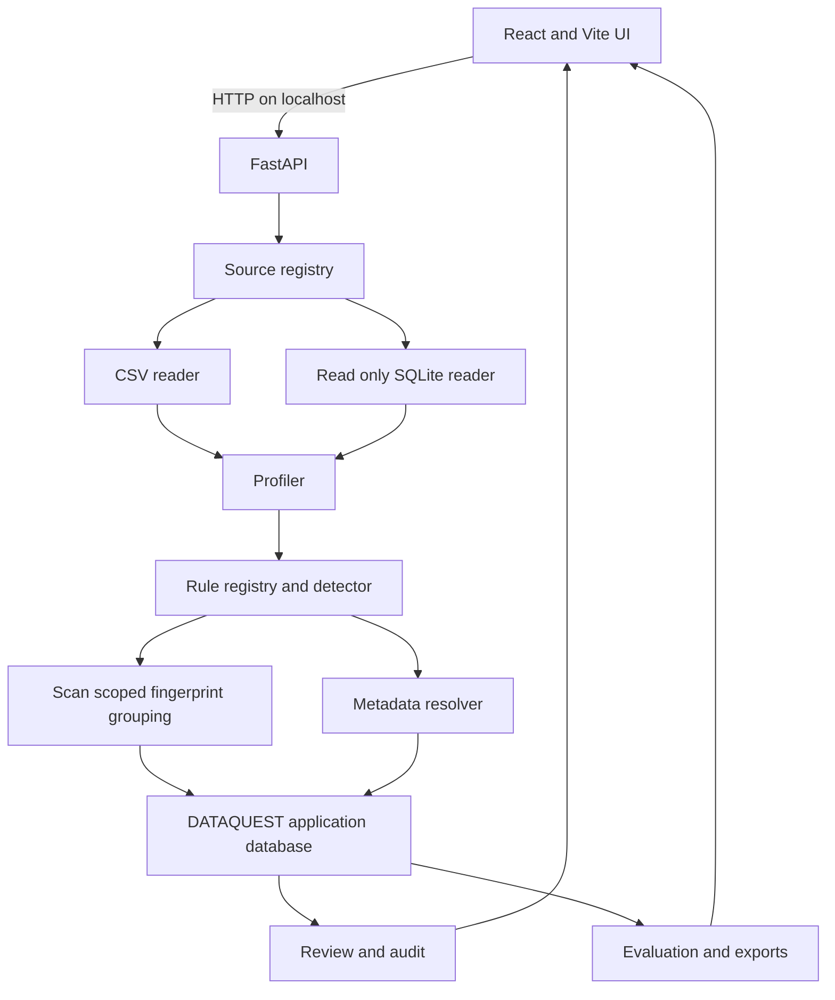

# DATAQUEST Architecture

## System boundary

DATAQUEST runs on one computer. The React/Vite browser client calls FastAPI on `127.0.0.1`. FastAPI owns ingestion, profiling, detection, metadata mapping, review, evaluation, and export. A dedicated application SQLite database stores local state separately from uploaded SQLite sources.

## Data flow

1. The source registry validates a filename, extension, size, and SQLite signature, then writes a server-named local copy.
2. CSV or SQLite readers return bounded field values in backend memory. SQLite uses a read-only URI and safely quoted identifiers.
3. The profiler calculates counts, inferred types, warnings, and masked samples.
4. The detector applies the current versioned rules to normalized field names and bounded values.
5. Candidate raw values stay in backend memory. A random per-scan secret generates keyed group identifiers for conservative same-class comparisons.
6. The footprint builder stores an opaque group ID and masked representative. It does not store raw values or a reusable HMAC key.
7. The metadata resolver selects the most specific applicable declaration and records purpose/retention status.
8. Findings default to `needs_review`. Each decision updates current state and appends a review event in one transaction.
9. Evaluation matches exact source/object/field/class tuples against the manual label file.
10. Export services select masked/redacted columns and neutralize spreadsheet formulas.

## Modules

- `app/main.py`: HTTP routes, validation, orchestration, and local-only configuration.
- `app/processing.py`: readers, profiler, detector, metadata resolution, and footprints.
- `app/rules.py`: five editable rule classes and versioned validation.
- `app/evaluation.py`: gold-label loading and confusion-matrix arithmetic.
- `app/exporting.py`: masked CSV, JSON, Markdown, and HTML outputs.
- `app/db.py`: schema, transactions, identifiers, timestamps, and redacted audit events.
- `frontend/src/App.tsx`: complete twelve-page workflow and API-derived views.

## Production hardening path

A production deployment should add authenticated user boundaries, a durable job queue, schema migrations, encrypted storage, malware scanning, content-security headers, signed release builds, threat modeling, load tests, accessibility audits, and independent security/privacy review. Those controls are outside this local hackathon prototype.

